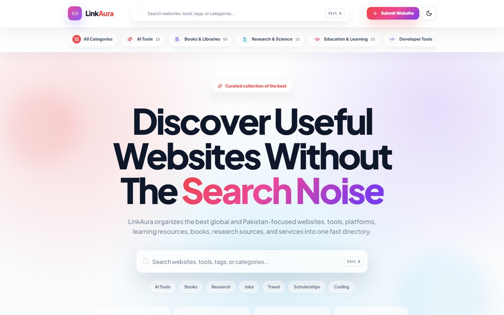

# LinkAura

🔗 **Live:** https://link-aura-ruby.vercel.app



LinkAura is a premium directory platform for discovering curated websites, tools, learning resources, digital libraries, research sources, travel platforms, utilities, and services.

## Tech Stack

- React
- Vite
- TypeScript
- Tailwind CSS
- Framer Motion
- Zustand

## Local Development

```bash
npm install
npm run dev
```

## Build

```bash
npm run typecheck
npm run build
npm run preview
```

## Netlify Deployment

Netlify settings:

- Build command: `npm run build`
- Publish directory: `dist`
- Node version: `18` or `20`

The `netlify.toml` file includes the SPA redirect rule so direct refreshes on routes such as `/library`, `/category/ai-tools`, and `/admin/feedback` resolve to `index.html` instead of a 404.

## Scripts

- `npm run dev`: Start the Vite dev server
- `npm run build`: Create the production build
- `npm run preview`: Preview the production build locally
- `npm run typecheck`: Run TypeScript checks
- `npm run lint`: Run ESLint
